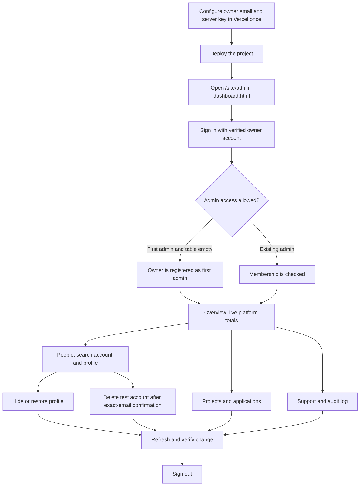

# Stagerang owner/admin journey

This is the platform owner’s workflow inside Stagerang. It describes the controls present in the current admin console and the outcome expected after each action.

## One-time preparation

1. In Vercel, open the Stagerang project’s **Settings → Environment Variables**.
2. Confirm `STAGERANG_ADMIN_EMAIL` is exactly `ratnabharati.rb@gmail.com` and is set for Production.
3. Confirm `SUPABASE_SERVICE_ROLE_KEY` is present as a server-only variable. Do not add `NEXT_PUBLIC_` to its name, put it in browser code, or share its value.
4. Keep `NEXT_PUBLIC_SUPABASE_URL` and `NEXT_PUBLIC_SUPABASE_PUBLISHABLE_KEY` configured as they are for the website.
5. Redeploy after changing environment variables. No new SQL is required for this admin workflow.

## Open and sign in

1. Visit `https://www.stagerang.com/site/admin-dashboard.html`.
2. Sign in with the verified owner Stagerang account `ratnabharati.rb@gmail.com` and its current password.
3. If there are no platform admins yet, the server registers this exact, verified owner as the first admin. If an admin already exists, membership is checked and first-owner setup does not run again.
4. If access is denied or configuration is missing, read the notice shown on the page. Confirm the Vercel variables and successful Production deployment. Never bypass the check by making a public admin button.

## Review platform status

The **Overview** cards show current totals for profiles, projects, applications, conversations, support requests, and admin actions. The console refreshes its open section and overview about every 20 seconds while visible. Click **Refresh data** to refresh immediately. The page displays the last successful refresh time.

These are records currently in the connected Supabase project. A count is not a quality check: if a workflow did not save its record, it will not appear in the related admin view.

## Find and manage a member

1. Click **People**.
2. Search by the member’s name, email, or account type. Use **Previous/Next** to move through result pages.
3. Check the email, account type, joined date, project count, profile name, and discovery status before acting.
4. Click **Hide profile** to remove the profile from member discovery. This preserves the account and its records. Use **Show profile** later to restore discovery visibility.
5. To remove a test account, click **Delete test account**, type the exact email shown, then confirm the second prompt. Deletion is permanent and linked records may be removed by the existing database cascade rules. The console blocks deletion of the admin currently signed in.
6. After either action, confirm the updated row and check **Audit log** for the recorded admin action.

Only delete accounts made for testing or accounts whose deletion has been authorized. For a real user who should simply be less visible, hide the profile instead.

## Review platform activity

- **Projects:** review recent project records, owners, owner account types, categories, statuses, and dates.
- **Applications:** review project, applicant, account type, status, application note, and received date. These are application notes, not private chat transcripts.
- **Support:** review submitted support requests and the member who sent each one.
- **Audit log:** review recorded admin actions, the affected record, and action details.

Use the **Refresh data** button or wait for the periodic refresh when checking new activity.

## Privacy and limits

- Private conversation message bodies are not shown in the admin console. Only the overview conversation count is shown.
- The current console does not edit projects/applications, grant admin roles, reset user passwords, resolve support requests, export data, or suspend accounts.
- Social-network authorization/follower syncing and Google Calendar integrations are separate unfinished product integrations.
- Admin activity is audited. Keep the owner login private, sign out on shared computers, and do not expose the service-role key.

## Quick test after deployment

1. Open the admin URL and sign in as the owner.
2. Confirm Overview totals load without an error.
3. Search for a known test account in People and verify its account type/email.
4. Hide that test profile, confirm it becomes **Hidden**, restore it, and confirm it becomes **Visible**.
5. Check one known project and application in their tabs.
6. Check **Audit log** for the visibility changes.
7. Do not test account deletion on the owner or on an account with data you need. If deletion behavior must be verified, create a disposable test user first.
