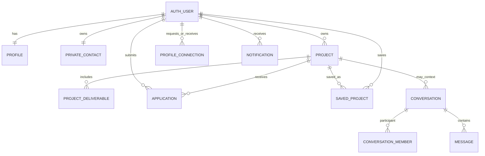

# Database Documentation — Brand Media Collab

**Source:** ordered files in `supabase/migrations/` (30 SQL files); reviewed 22 November 2026. This document describes checked-in DDL, **not** the currently hosted Supabase schema. Reconcile the migration ledger before applying any SQL.

## Database services and conventions

- Supabase Auth owns member credentials and identity (`auth.users`). Password hashes stay within Supabase Auth; no password column exists in the public schema.
- Public business records use UUID keys (mostly `gen_random_uuid()`); account-owned records refer to `auth.users.id`.
- Timestamps are `timestamptz`, usually `created_at` and `updated_at`.
- Profile arrays are PostgreSQL `text[]`; flexible per-deliverable records use `jsonb`.
- The UI uses Supabase JS/PostgREST from the browser with the publishable key and signed-in session. RLS must remain enabled.

## Table inventory and principal columns

Fields below are consolidated from the initial schema plus additive migrations. “Additional” means that field appears in a later migration; verify installed schema before relying on it.

| Table | Principal columns/types | Keys, links, purpose |
|---|---|---|
| `profiles` | `id uuid`, `account_type text`, `display_name text`, `company_name text`, `agency_type text`, `bio text`, `category text`, `location text`, `website_url text`, `content_categories text[]`, `follower_tier text`, `is_discoverable boolean`, `avatar_url text`, `created_at/updated_at timestamptz`; additional `languages text[]`, `manager_name/title text`, `collaboration_categories/services/specialisations/portfolio_links text[]`, `onboarding_completed boolean`, `profession text`, `skills/content_formats/media_types/event_types/client_industries text[]`, `company_type/audience_type/event_scale/representation_status text`, `availability_status text`, `availability_date date`, `community_type/membership_type/member_range/work_preference text`, `distribution_regions/business_capabilities text[]`, `is_verified boolean`. | PK/FK `id → auth.users.id ON DELETE CASCADE`. Nine-type check. Public display data and discoverability. Profile completion is computed for admin directory; it is not listed as a stored profile column. |
| `private_contacts` | `user_id uuid`, `email text`, `phone text`, later `full_name text`, timestamps. | PK/FK to Auth user, cascade. Private contact values; separate owner/admin access policies. |
| `platform_admins` | `user_id uuid`, `created_at timestamptz`. | PK/FK to Auth user, cascade. Trusted platform role; no public signup selection. |
| `social_accounts` | `id uuid`, `user_id uuid`, `platform text`, `profile_url text`, `follower_count bigint`, `engagement_rate numeric(6,3)`, `last_synced_at/created_at timestamptz`. | PK; FK to Auth user; unique `(user_id, platform, profile_url)`. URLs/count fields do not establish a working OAuth sync. |
| `projects` | `id uuid`, `owner_id uuid`, `owner_type text`, `project_type text`, `project_name/category/requirements text`, `location text`, `application_deadline/delivery_date/timeline_start/timeline_end date`, `creator_tiers/platforms text[]`, `usage_permissions/reshare_permissions text`, `budget_by_deliverable jsonb`, `status text`, timestamps. Additional: `target_profile_types/required_skills/required_languages text[]`, `required_collaborators jsonb`, `moderation_status/reason text`, `moderated_by uuid`, `moderated_at timestamptz`. | Owner FK to Auth user, cascade. Nine `owner_type`/project-type classifications; trigger derives them from owner profile on insert and blocks reassignment. |
| `project_deliverables` | `id uuid`, `project_id uuid`, `deliverable_type text`, `amount_min/amount_max numeric(12,2)`, `currency text`, `details text`, `created_at timestamptz`. | FK to project, cascade. |
| `applications` | `id uuid`, `project_id uuid`, `applicant_id uuid`, `status text`, `message text`, `created_at/updated_at timestamptz`. | Project/Auth FKs cascade; unique `(project_id, applicant_id)`. Status check includes `interested`, `rejected`, `working_together`, `withdrawn`; trigger/grants constrain identities and transitions. |
| `saved_projects` | `user_id uuid`, `project_id uuid`, `created_at timestamptz`. | Composite PK `(user_id, project_id)` and cascading FKs. |
| `conversations` | `id uuid`, `project_id uuid nullable`, `created_by uuid`, `is_group boolean`, `created_at timestamptz`. | Project deletion sets null; creator Auth FK cascade. Conversation guard supports eligible one-to-one project chat. |
| `conversation_members` | `conversation_id uuid`, `user_id uuid`, `joined_at timestamptz`. | Composite PK; cascading conversation/Auth FKs. Participant membership drives message access. |
| `messages` | `id uuid`, `conversation_id uuid`, `sender_id uuid`, `body text`, `read_at/created_at timestamptz`. | Conversation/Auth FKs cascade. Message reads and sends are participant-scoped. |
| `meetings` | `id uuid`, nullable `project_id uuid`, `organizer_id/attendee_id uuid`, `title text`, `starts_at/ends_at timestamptz`, `calendar_event_url text`, `created_at timestamptz`. | Project deletion sets null; party Auth FKs cascade. Calendar URL field does not prove provider integration. |
| `support_requests` | `id uuid`, `user_id uuid`, `subject/description text`, `status text`, timestamps. | Auth owner FK cascade; status `open/in_progress/resolved`. |
| `payment_records` | `id uuid`, nullable `project_id/payer_id/payee_id uuid`, `amount numeric(12,2)`, `currency text`, `status text`, `provider_reference text`, `created_at timestamptz`. | Optional linked project/users; payment table only, no checkout implementation verified. |
| `admin_audit_logs` | `id bigint identity`, nullable `admin_id uuid`, `action/entity_type/entity_id text`, `details jsonb`, `created_at timestamptz`. | Admin FK sets null on deletion; records operator actions. |
| `notifications` | `id/user_id/actor_id/project_id/application_id/conversation_id`, `type/title/body`, `read_at/created_at`. | Owner Auth FK cascade; actor/project set null; application/conversation cascade. Types include application received/status and new message. |
| `profile_connections` | `id uuid`, `requester_id/recipient_id uuid`, `status text`, timestamps, `accepted_at timestamptz`. | Auth FKs cascade; no-self check and unique unordered pair index. Status pending/accepted/declined/canceled. |
| `profile_blocks` | `blocker_id/blocked_id uuid`, `created_at timestamptz`. | Composite PK, no-self check, Auth FKs cascade. |
| `admin_account_states` | `user_id uuid`, `status text`, `reason text`, `changed_by uuid`, `changed_at timestamptz`. | PK/Auth FKs; status active/suspended; suspended status requires a reason. Service-role-only privileges in source. |
| `content_reports` | `id/reporter_id/target_user_id/target_project_id/reviewed_by uuid`, `reason/description/status/resolution text`, `reviewed_at/created_at timestamptz`. | Exactly one target; no self-report; report reason/status checks. Reporter may create/read own, admin reviews. |
| `verification_requests` | `id/user_id/reviewed_by uuid`, `statement/status/review_note text`, `reviewed_at/created_at timestamptz`. | Owner read/insert and admin review policies; partial unique index allows one pending request per user. |

### Absent entities

No `teams`, `team_members`, `invitations`, `account_settings`, dedicated analytics event table, or billing subscription/payment-intent table was found. Product copy must not imply those workflows exist.

## Relationships

Delete behavior is mainly cascade for account-owned data and children. Some historical/moderation links use `SET NULL`; projects referenced by meetings/conversations may be nulled. Confirm effects before running admin deletion in production.

## Constraints and indexes

- Profiles allowed type constraint expands to nine types. Profile completion trigger validates required fields by type, including private phone format (`+` international format), creator/freelancer private name, creator/freelancer avatar, freelancer skill/profession, celebrity profession, and organization-specific fields.
- Project classification trigger sets project type based on owner account type; ownership cannot be reassigned by ordinary project update.
- Project discovery indexes include owner/date and status/deadline; applications index project/date and applicant/date; messages index conversation/date; migrations add foreign-key indexes and indexes on notifications, reports, verification, and connections.
- Applications enforce one record per project/applicant and guard insert/update against self-application, closed/expired project, wrong target type, and invalid state/identity changes.
- Saves, memberships, connection pairs, pending verification have unique constraints/indexes to avoid duplicates.

## RLS, grants and authorization

RLS is enabled in checked-in migrations for core member/admin tables. The policy intent is:

- `profiles`: authenticated read of discoverable profiles, own profile and authorized admin; self insert/update, admin limited support. `is_discoverable` default is changed to false by migration.
- `private_contacts`: owner/admin read; owner writes.
- `projects`: open/discoverable project, owner, or admin read; owner create/update/delete with database guards.
- `applications`: applicant, owning project owner, or admin read; applicant creates own row; party transitions constrained via trigger and column grants.
- `saved_projects`: owner-only CRUD.
- `conversations`, `conversation_members`, `messages`: member/creator-only read and eligible participant insert/send; accepted-project chat enforced by trigger/policy.
- `notifications`: owner reads and may update only `read_at`.
- `profile_connections`, `profile_blocks`: participants/owner scoped, request mutation validated by trigger.
- `content_reports` and `verification_requests`: submitter owns request; platform admin review.
- `admin_account_states`, admin views: service role only; platform admin routes authorize before service access.
- Suspension: restrictive `account_active_gate` policy calls `app_private.is_account_active()`; RLS is not disabled.

This is SQL source review. It does not prove hosted roles, policies, views, functions, or publication membership match this chain.

## Functions and triggers

Names observed across migrations include `app_private.is_platform_admin()`, `app_private.is_account_active()`, `app_private.handle_new_user()`, `public.enforce_project_owner_classification()`, profile completion/private-contact validation, `public.discover_profiles(...)`, `public.has_applied_to_project(...)`, application write guards, connection write guards and notification function, project-chat guard, and notification triggers for applications and messages. Exact function revisions must be read from the newest applicable migration; duplicate historical copies at repository root are not canonical.

## Storage and Realtime

- Bucket `avatars`: public read; owner insert/update/delete by path policy; 5 MiB size limit; MIME allowlist JPEG/PNG/WebP in `202611150002_avatar_storage.sql`.
- Realtime subscriptions are in browser modules for messages, notifications, connections, projects/applications, and dashboard activity. Messages and notifications are user/member filtered where implemented. Do not assume hosted Realtime publication is enabled; verify it in Supabase.
- No private portfolio/document bucket or policy set was found in this audit.

## Migration index

Migration files in timestamp order (30):

1. `202611150001_initial_schema.sql`
2. `202611150002_avatar_storage.sql`
3. `202611160001_activity_notifications.sql`
4. `202611170001_saved_projects_visibility.sql`
5. `20261117050303_enable_creator_dashboard_realtime.sql`
6. `20261117075041_enforce_authenticated_project_roles.sql`
7. `20261118052016_platform_admin_private_helper.sql`
8. `20261118052017_fix_platform_admin_helper_references.sql`
9. `20261118143746_add_creator_availability_fields.sql`
10. `20261118155841_enable_conversation_members_realtime.sql`
11. `20261118160423_enforce_accepted_project_conversations.sql`
12. `202611190001_complete_profile_details.sql`
13. `202611190002_add_role_profile_fields.sql`
14. `202611190003_fix_phone_validation_pattern.sql`
15. `202611190004_use_invoker_admin_compatibility.sql`
16. `20261119000500_explore_discover_connections.sql`
17. `20261119000600_allow_chat_creator_membership.sql`
18. `20261119000700_allow_unblock_management.sql`
19. `20261119000800_default_profiles_to_private_until_opt_in.sql`
20. `20261119000900_six_type_collaboration_ecosystem.sql`
21. `20261119001000_enable_profile_discovery_realtime.sql`
22. `20261120085108_add_missing_foreign_key_indexes.sql`
23. `20261120091936_handle_new_user_six_types.sql`
24. `20261120094418_creator_profile_requirements.sql`
25. `20261120101805_admin_moderation_directory.sql`
26. `20261120102951_enforce_admin_moderation_visibility.sql`
27. `20261120103626_admin_profile_completion_indexes.sql`
28. `20261120104016_enforce_active_storage_accounts.sql`
29. `20261120120000_phase5_application_integrity.sql`
30. `20261121130000_expand_to_nine_account_types.sql`

The profile discovery publication migration was referenced by `SUPABASE-UPDATE-GUIDE.md` but had been left at repository root. It is now also present in the canonical migration directory at item 21 above. The original root copy is a stale duplicate and is excluded from delivery.

## Safe operator procedure

1. Back up the database and use a non-production Supabase project first.
2. Compare Supabase migration history against all files listed above; inspect schema/functions/policies already deployed.
3. Apply only missing migrations in order using the selected workflow (Supabase CLI/history or SQL editor with a tracked migration record).
4. Do **not** rerun the initial schema against an existing populated project or paste the entire directory as one arbitrary batch.
5. Verify profile creation for all nine types, discoverability privacy, application transitions, accepted-chat restrictions, connection uniqueness, notifications, admin metrics and suspension policies using separate test accounts.
