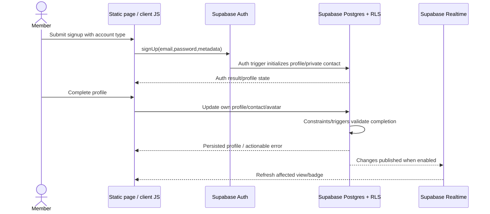
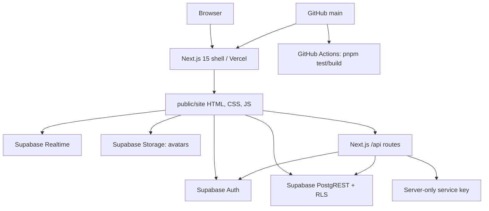

# Brand Media Collab — Master Project Document

**Document status:** Source-verified project snapshot, 22 November 2026  
**Purpose:** Central product and technical source of truth for the current repository.  
**Evidence rule:** “Implemented in source” means code or SQL exists in this checkout. It does not mean it is deployed, configured in Supabase, or verified end to end.

## 1. Project overview

| Item | Current understanding |
|---|---|
| Product | Brand Media Collab (BMC) |
| Category | Business-to-business creative collaboration and opportunity discovery |
| Vision | Make it easier for organizations and creative professionals to find suitable partners and turn opportunities into work. |
| Mission | Give nine kinds of participants a shared place to present discoverable profiles, publish collaboration opportunities, respond to projects, build connections, and communicate. |
| Problem | Finding the right collaborators is fragmented, time-consuming, and difficult to manage across separate social channels and informal referrals. |
| Solution | A member network with profiles, discovery, projects, applications, saved opportunities, connections, project conversations, notifications, dashboards, and a protected owner console. |
| Primary audience | Creators, brands, agencies, celebrities, event businesses, media organizations, communities, distributors, and freelancers. |
| Business model | Not established by the checked-in implementation. Payment records exist in the schema, but no checkout, billing provider, plans, or revenue workflow is documented as working. |
| Primary domain in source | `https://www.brandmediacollab.com` (DNS/Vercel ownership and live response were not checked here). |

### Value proposition and positioning

BMC is positioned as a shared creative-business network rather than a single-purpose influencer marketplace. It connects people and organizations that may originate, fund, produce, distribute, host, or amplify work. The source supports nine profile classifications and maps each to a matching project classification. There is not yet evidence of a proprietary matching algorithm, verified reach data, escrow, campaign analytics, or paid marketplace mechanics; these should not be claimed in product copy until implemented.

## 2. Product concept and core model

Members create a Supabase-authenticated account, choose one of nine public account types, complete a profile, and optionally make it discoverable. They can browse profiles and projects, filter/search, save opportunities, express interest/apply, review applications on projects they own, and communicate through project-linked or accepted-connection conversations. Notifications record relevant activity. Dashboards summarize account/project/application/message activity. Platform administration is separate from public member roles and uses server-authorized API routes.

### Why a member may choose BMC

- One collaboration-oriented directory for multiple creative-business participants.
- Profiles and project listings include industry/category, location, platform, language, services, and role information where the schema supports it.
- Project application state, saved projects, conversations, and notifications are connected to persisted records rather than being intentionally presented as a static demo.
- Admin moderation and audit structures exist in source.

Competitive differentiation has not been validated through market research in this repository. Do not represent the list above as proven superiority over competitors.

## 3. User types and access model

All public account types use the shared `profiles` model and common authentication. The database enforces allowed account types and derives project owner/project classification from the saved profile. The implementation does not establish a distinct permission matrix for every public type; most authorization is by ownership, participant membership, connection/application state, discoverability, and admin status.

| Type | Intended role and goals | Current type-specific data/behavior | Access limits / gaps |
|---|---|---|---|
| Creator | Individual creator seeking briefs and partnerships. | Individual profile; category, bio, location, languages, platforms/social links, portfolio, avatar; project type `creator_idea`; required photo/name/phone constraints at profile completion. | Cannot create an admin role; private chat is gated by accepted collaboration/connection rules. Live journey untested. |
| Brand | Company looking for creators and campaign partners. | Organization profile; industry/category, description, company, primary contact; project type `brand_campaign`. | Owner-scoped project/application controls; no verified billing or campaign measurement. |
| Agency | Service organization managing client or production opportunities. | Organization profile with required `agency_type`; project type `agency_project`. | Team invites are not implemented as a persisted workflow. |
| Celebrity | Public figure/talent seeking opportunities. | Individual profile with profession/category; project type `celebrity_project`; representation status exists in schema history. | No agent/representation access controls verified. |
| Event | Event company/organizer seeking talent or partners. | Organization-style profile; project type `event_project`. | Event scheduling/ticketing/calendar integrations are not implemented or verified. |
| Media | Publisher/media organization seeking stories, talent, or campaigns. | Organization-style profile; project type `media_project`. | No media-kit analytics or publication integrations verified. |
| Community | Online/local community seeking partner opportunities. | Community profile fields include `community_type`, `membership_type`, and `member_range`; project type `community_project`. | No member-management or invitations workflow. |
| Distributor | Distribution business seeking brands, products, and market partners. | Fields include distribution regions and business capabilities; project type `distribution_project`. | No catalog, order, or channel transaction workflow. |
| Freelancer | Independent professional offering skills/services. | Individual profile; profession, skills, portfolio, availability/work preference; project type `freelance_project`; completion requires photo, profession, skill, private name and phone. | No contracts, invoicing, or time-tracking workflow. |
| Platform admin | Trusted platform owner/operator. | Admin membership is stored in `platform_admins`; owner UI uses backend API, service role, allowlisted email bootstrap, moderation, user directory, metrics, audit. | Not selectable at public signup. Hosted authorization and moderation flows were not tested. |

### Access rules visible in source

- Supabase Auth establishes identity; `auth.uid()` scopes member-owned rows.
- Profile/project/application/conversation policies check ownership or participant status.
- Hidden profiles default to non-discoverable after the migration that changes the default; members opt in.
- A restrictive account-active policy is intended to block suspended accounts.
- Admin APIs call a server-side admin guard. Browser role labels alone do not grant admin.
- Public avatars are stored in a public bucket; private contact details are in a separate table with owner/admin policies.
- These are migration/code findings, not confirmation of the live project’s applied state.

## 4. Feature inventory and implementation status

Status labels: **Source present, live unverified** = code exists but no live backend test; **Partial** = relevant source exists with a known gap; **Missing** = no implementation found; **Planned** = roadmap only.

| Feature | Audience | Current status and source evidence | Main dependencies / note |
|---|---|---|---|
| Landing, brand copy, SEO metadata | Visitors | Source present; landing page has metadata, canonical, social tags and JSON-LD. Live indexing not checked. | Domain, Search Console, social preview validation. |
| Signup/login/logout/session | All members | Source present, live unverified (`index.html`, `bmc-app.js`, Auth trigger migrations). | Supabase Auth URL/provider settings and keys. |
| Password reset | All members | Source present, live unverified (`reset-password.html`, `password-reset.js`). | SMTP/provider, redirect allowlist. |
| Nine-type onboarding/profile | Nine public types | Source/schema present; live validation not tested. | Apply role expansion migration; test all required fields/storage. |
| Profile view/edit/discovery | Members | Source present, live unverified. Explore calls `discover_profiles`; privacy defaults to opt-in. | Hosted RPC/RLS and profile data. |
| Project create/edit/discover | Members | Source present for nine project classifications, filters and Realtime handlers. | Migrations, RLS, real records. |
| Save/unsave opportunities | Members | Source present using `saved_projects`; not live tested. | Unique key/RLS. |
| Applications/status changes | Applicants/project owners | Source present with database integrity guards and status model (`interested`, `rejected`, `working_together`, `withdrawn`). | Migration application and two-account tests. |
| Connections/blocks | Members | Source present in `profile_connections` and `profile_blocks`; live unverified. | RLS, trigger, Realtime, notifications. |
| Messages/project chat | Eligible participants | Source present; conversations/members/messages, private chat restrictions and Realtime hooks. | Accepted project/connection eligibility, hosted Realtime and RLS. |
| Notifications | Members | Source present, persisted/paginated, mark-read controls and user-scoped subscription. | Trigger migrations and Realtime publication. |
| Dashboard | Members | Source present with live query/refetch logic; no hosted accuracy check. | RLS and current data. |
| Owner admin | Admin | Source present for metrics, paginated users, report/verification review, suspend/restore, delete, project moderation, audit. | Owner bootstrap, server env, deployed migration and live authorization tests. |
| Reports/verification | Members/admin | Source present in API and schema. | Supabase migrations, abuse/rate-limit policy. |
| Support requests | Members/admin | Table/UI/API source partially present. | Hosted workflow and service operations. |
| Team invites | Agencies/orgs | **Missing as a persisted workflow**; no teams/invitations table. | Product decision and schema/API/UI required. |
| Billing/monetization | Future | **Missing**. `payment_records` is only a database record structure, not a checkout system. | Product/business requirements, payment provider, security review. |
| Social OAuth/follower sync | Members | **Missing/partial**. Users can store public social URLs; authorized syncing not implemented. | Platform APIs, OAuth, provider review. |
| Calendar/meeting integration | Members | `meetings` table exists; calendar integration is not verified. | Provider OAuth and scheduling UX. |
| Analytics events/funnels | Product owner | **Partial**. GTM container ID is embedded in many HTML pages; no audited event taxonomy or GTM container contents. | GTM/GA property access, consent/privacy design. |
| Responsive visual/E2E QA | All | **Not verified at viewport/browser level**. CSS/source verifier only. | Browser runner and authenticated test accounts. |

## 5. Sitemap and access map

Active public/application HTML is under `public/site/`; the Next.js root `/` serves `index.html` through an iframe. The 24 HTML pages counted by the repository verifier are:

| Page/file | Audience/access | Intended role |
|---|---|---|
| `index.html` | Public, indexable | Landing, sign-in/signup entry |
| `landing-preview.html` | Preview only, noindex | Historical design preview; not canonical |
| `feed.html` | Authenticated | Home activity/project feed |
| `projects.html` | Authenticated | Discover/project directory |
| `project-form.html` | Authenticated | Create/edit project |
| `my-projects.html` | Authenticated | Member-owned projects |
| `saved-opportunities.html` | Authenticated | Saved projects |
| `applications.html` | Authenticated | Sent/received applications and statuses |
| `explore.html` | Authenticated/noindex | Discover profiles and filters |
| `creator-profile.html`, `brand-profile.html` | Redirect/compatibility routes | Legacy role-specific profile entrypoints |
| `my-profile.html`, `edit-profile.html` | Authenticated | View/edit own profile |
| `profile-setup.html` | Authenticated/onboarding | Complete initial profile |
| `dashboard.html` | Authenticated | Account-specific activity/metrics |
| `dashboard-preview.html` | Preview/noindex | Dashboard visual preview |
| `messages.html` | Authenticated/participant scoped | Conversations and messages |
| `notifications.html` | Authenticated/owner scoped | Notification center |
| `settings.html` | Authenticated | Account/privacy settings |
| `logout.html` | Authenticated/action | Sign out |
| `reset-password.html`, `update-password.html` | Recovery/session flow | Request/apply password reset |
| `help.html` | Public/member help | Help/support entry |
| `admin-dashboard.html` | Authenticated platform admin | Admin console |

`robots.txt` allows crawling generally and points to a one-URL sitemap (homepage). Authenticated pages use `noindex` in source where checked. No dedicated About, Terms, or Privacy page was found in the active HTML sitemap; footer links need a product/content decision and route verification.

## 6. User journeys

The complete step-by-step shared and role-specific journeys, alternative paths, and failure handling are in [USER-JOURNEYS.md](USER-JOURNEYS.md). The core path is:

```mermaid
flowchart LR
  V[Visitor] --> L[Landing]
  L --> A[Sign up / log in]
  A --> P[Supabase Auth + profile initialization]
  P --> O[Role-specific onboarding]
  O --> H[Home / dashboard]
  H --> D[Explore profiles or projects]
  D --> R[Connect / save / apply]
  R --> N[Persisted notification and status]
  N --> C[Eligible private conversation]
  C --> X[Continue collaboration]
```

Failure alternatives include validation errors, duplicate email/Auth errors, unverified/expired recovery link, missing Supabase config, RLS rejection, upload failure, empty discovery, closed/expired/ineligible projects, duplicate connection/application, unauthorized conversation, and offline Realtime (poll/refetch fallback). Live behavior of these paths still requires execution against a test Supabase project.

## 7. Major system workflows

Project lifecycle: authenticated owner creates an open/draft project → trigger derives owner/project classification from stored profile → discovery query applies status, target type and filters → applicant inserts one application per project → owner changes allowed status → notification triggers create records → accepted status enables a private project chat. RLS and triggers enforce the rules in SQL; the browser is not the security boundary.

Connection lifecycle: requester creates one unordered-pair request → trigger validates parties and blocks/duplicates/status transitions → recipient accepts/rejects → database notification and Realtime refresh both participant views. Message lifecycle: eligible participants are added to a conversation → participant sends a message → RLS verifies membership → database trigger creates notification → thread, unread state, and badge refresh.

## 8. Database/backend summary

Supabase Auth is identity source; Postgres is intended source of truth. The canonical migration directory has 30 SQL files. The profile discovery publication migration was referenced by the Supabase guide but stranded at repository root; this audit has placed it in the canonical migration directory and documents the old root copy as an excluded duplicate. Main entities: `profiles`, `private_contacts`, `platform_admins`, `social_accounts`, `projects`, `project_deliverables`, `applications`, `saved_projects`, `conversations`, `conversation_members`, `messages`, `meetings`, `support_requests`, `payment_records`, `admin_audit_logs`, `notifications`, `profile_connections`, `profile_blocks`, `admin_account_states`, `content_reports`, and `verification_requests`.

Important relationships and controls:

- `profiles.id` and `private_contacts.user_id` reference `auth.users.id`.
- Project children use project foreign keys; applications are unique by `(project_id, applicant_id)`; saved items by `(user_id, project_id)`; membership by `(conversation_id, user_id)`.
- Connections enforce unique normalized user pairs in a trigger/index design; verification permits one pending request per user.
- RLS is enabled in source for core tables. Admin directory/metrics views are restricted to `service_role`; admin routes authorize before using the server key.
- Avatar storage bucket is public-read, with owner-only writes in policy source and 5 MiB JPEG/PNG/WebP limit.
- No `teams`, `invitations`, or `account_settings` table is present.

See [DATABASE_DOCUMENTATION.md](DATABASE_DOCUMENTATION.md) for table fields, constraints, migrations, policies, triggers, storage, and source-versus-live caveats.

## 9. Frontend and design system

- Frontend: 24 static HTML screens, page-owned CSS and browser JavaScript in `public/site/`; shared `design-system.css/js` applies common typography/components/icons. The Next.js root wraps the landing HTML in an iframe.
- Shared body font: DM Sans → Arial/sans-serif. Display: Manrope → DM Sans → Arial/sans-serif. Google Fonts are loaded by HTML page heads; offline fallback is Arial.
- Shared colors: ink `#1b2b22`, muted `#788078`, paper `#f6f5f0`, surface `#fffefa`, border `#e9e7df`, green `#b9ee73`, deep `#293d30`. Landing page also contains `#f7f5f0`, `#192821`, `#66884e`, `#dff1e7`.
- Shared scale after current hygiene changes: internal H1 26–34px; hero H1 36–72px desktop and 32–52px mobile; section H2 20–24px; card H2 18px; body/control 16/14px; standard buttons 14px; dense feed controls 13px; shared weights 400/500/600/700 (Manrope may use 800).
- Spacing token set 4/8/12/16/20/24/32px. Control radius 10px; card radius 16px; focus ring 3px green translucent. Shared breakpoint 720px; page CSS also uses 850/900/700/650/480/380px.
- Icon set is local outline SVG, 18×18, stroke 1.8. Home feed project tabs now wrap (two columns on mobile) rather than horizontal-scroll.
- The exact tokens and where styles remain page-specific are in [PHASE-6-DESIGN-SYSTEM-REPORT.md](PHASE-6-DESIGN-SYSTEM-REPORT.md) and [PROJECT_AUDIT_REPORT.md](PROJECT_AUDIT_REPORT.md).

## 10. Technical architecture

Technology: Next.js 15.5.x, React 19, TypeScript for server routes, vanilla browser JavaScript/static HTML for application screens, Supabase Auth/Postgres/Storage/Realtime, pnpm lockfile v9. Hosting is configured for Vercel in project docs; deployment status was not accessed. Detailed files and route methods appear in [TECHNICAL_ARCHITECTURE.md](TECHNICAL_ARCHITECTURE.md).

## 11. Security, privacy, and data protection

Source controls include Supabase Auth, RLS, ownership/participant policies, restricted admin tables/views, server-side `requirePlatformAdmin`, server-only service key, input allowlists/UUID validation in admin routes, protected UI routes, project/application/connection guard triggers, and audit logging. Sensitive user email/phone are kept separate from discoverable profile fields. No secrets or user records belong in the ZIP.

Open verification tasks: compare hosted migrations/RLS/storage policy state; test authorization with two ordinary accounts and one admin; review rate limiting and abuse controls on report/signup endpoints; decide on analytics consent and remove tracking from private/admin screens if not appropriate; verify Auth email behavior and deletion cleanup for every storage bucket. No penetration test or hosted RLS query was run.

## 12. SEO and discoverability

Homepage has title/description, canonical, robots, Open Graph, Twitter card, Organization/WebSite JSON-LD and an image. `robots.txt` references a sitemap containing only `/`. Preview and key authenticated pages are marked noindex. Dynamic profile/project pages are not currently delivered as crawlable public routes. See [SEO_CHECKLIST.md](SEO_CHECKLIST.md) for existing implementation, gaps, and safe roadmap. Verify domain ownership, Search Console, sitemap fetch, canonical redirects, structured data, Core Web Vitals, and social cards after DNS/deployment.

## 13. Analytics

GTM container ID `GTM-N843Z826` is embedded in 22 active HTML pages in source. The repository does not contain the owner’s GTM container configuration, a verified GA4 Measurement ID, a defined event schema, conversion-funnel validation, consent-management implementation, or analytics account access. Current snippet presence proves only source inclusion. Analytics pageviews/events, signup attribution, and privacy settings require verification in GTM/GA4. Do not send email, phone, message body, or private profile data as analytics parameters.

## 14. Development and deployment

Prerequisites: Node 22+, pnpm 9+, Supabase project. Copy `.env.example` to ignored `.env.local`; never package real values. Install with `pnpm install --frozen-lockfile`, run `pnpm dev`, test with `pnpm test`, build with `pnpm build`. Vercel project root must be repository root; SQL migrations are applied separately and reviewed against migration history. GitHub Actions runs install, tests, and build. Refer to [README.md](README.md), [ENVIRONMENT_SETUP.md](ENVIRONMENT_SETUP.md), and [DEPLOYMENT_GUIDE.md](DEPLOYMENT_GUIDE.md).

## 15. Current limitations and roadmap

### Must verify before production certification

1. Apply/reconcile the 30 migration chain with the live project; inspect real RLS, Storage and Realtime configuration.
2. Run disposable signup/profile flows for all nine account types, then two-user project/application/connection/message/notification workflows and admin authorization/deletion tests.
3. Test responsive layouts and accessibility in a real browser at 360, 390, 768, 1024, and 1440px; verify no console/network failures.
4. Confirm Vercel root, production commit, env vars, DNS/TLS and domain redirect behavior.
5. Resolve missing product/legal surfaces: team invitations, account self-deletion, public SEO profile/project pages, terms/privacy/about/support routes, analytics consent/event plan, and billing scope.

### Priority roadmap

- **P0 security/release gate:** live RLS/Auth/Storage and admin authorization verification; incident/error monitoring and rate limits.
- **P1 core use:** complete browser E2E suite across roles, accessibility/responsive QA, transactional multi-step UX/error recovery.
- **P2 growth:** public canonical profile/project pages with privacy controls and search-friendly category pages; verified analytics funnel and consent.
- **P3 optional product expansion:** organization teams/invitations, calendar integration, social OAuth/metrics, payment/monetization after requirements are defined.

## 16. Related source-of-truth documents

- [PROJECT_AUDIT_REPORT.md](PROJECT_AUDIT_REPORT.md) — findings and priorities.
- [USER-JOURNEYS.md](USER-JOURNEYS.md) — role-by-role tasks and failure cases.
- [TECHNICAL_ARCHITECTURE.md](TECHNICAL_ARCHITECTURE.md) — modules, APIs, build and deployment topology.
- [DATABASE_DOCUMENTATION.md](DATABASE_DOCUMENTATION.md) — entities, relationships, policies and migrations.
- [SEO_CHECKLIST.md](SEO_CHECKLIST.md) — implemented SEO and recommendations.
- [CHANGELOG.md](CHANGELOG.md) — changes in this delivery.
- [DEPLOYMENT_GUIDE.md](DEPLOYMENT_GUIDE.md) and [ENVIRONMENT_SETUP.md](ENVIRONMENT_SETUP.md) — owner/developer operations.
- [END-TO-END-QA-REPORT.md](END-TO-END-QA-REPORT.md) — verified, blocked and untested checks.
