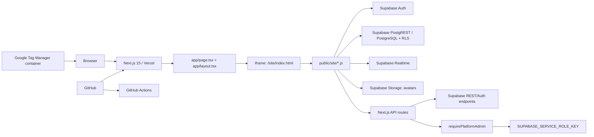

# Technical Architecture — Brand Media Collab

**As inspected:** 22 November 2026. Source map only; hosted infrastructure was not queried.

## System topology



## Runtime and repository layout

- **Next.js application:** `app/page.tsx` serves a full-viewport iframe pointing to `/site/index.html`. `app/layout.tsx` sets language and global metadata. `app/globals.css` styles the frame.
- **Product UI:** `public/site/` holds 24 active HTML screens, inline page CSS, browser modules, `design-system.css/js`, and the landing hero image. These files are the frontend source of truth; numbered HTML/JS/SQL files at repository root are historical copies and excluded from the canonical delivery ZIP.
- **Server API:** `app/api/` contains the Supabase public-config endpoint and authenticated report, verification, and admin endpoints.
- **Database:** `supabase/migrations/` holds 29 ordered SQL migrations. Vercel build does not apply SQL.
- **Verification:** `scripts/verify-site.mjs` parses source references and checks structural/auth/role/integrity/realtime assumptions. It does not execute browser interactions or query Supabase.
- **CI:** `.github/workflows/ci.yml` installs pnpm dependencies, runs `pnpm test`, then `pnpm build` on `main` pushes and pull requests.

## Technology inventory

| Layer | Implementation |
|---|---|
| Server rendering/hosting adapter | Next.js 15.5.x; Vercel configuration is described in deployment docs but account state was not inspected |
| UI | Static HTML, page-local CSS, vanilla JavaScript; one React/Next iframe shell |
| Server/API language | TypeScript, Next.js Route Handlers |
| Auth/data | Supabase Auth, PostgREST, PostgreSQL, RLS |
| File storage | Supabase Storage `avatars` bucket; public reads, owner-scoped writes in migrations |
| Live updates | Supabase Realtime Postgres changes for selected messages, notifications, connections, projects/applications and dashboard refreshes |
| Package management | pnpm; lockfile format 9 |
| Fonts/icons | Google Fonts DM Sans and Manrope, local SVG icon set |
| Analytics | GTM container ID `GTM-N843Z826` in 22 HTML pages; container tags/events unverified |

## Frontend module map

| File | Responsibility |
|---|---|
| `bmc-supabase.js` | Browser Supabase client/config bootstrap; only public URL/key belongs here. |
| `bmc-app.js` | Auth guards, signup/login/logout, profile initialization/display, home feed, shared account/nav activity. |
| `projects-live.js` | Project scopes/category tabs/search/filters/saves/applications/details and subscriptions. |
| `applications-live.js` | Sent/received application rendering and status/chat affordances. |
| `explore-live.js` | Calls `discover_profiles`, role-aware filters, profile cards, report UI, refresh subscriptions. |
| `connections-live.js` | Request/accept/decline/cancel/block state and related UI. |
| `messages-live.js` | Conversation discovery, project/connection eligibility, send/read/realtime/unread refresh. |
| `notifications-live.js` | Owner-scoped page, pagination, unread filters, mark-one/all-read and subscription. |
| `dashboard-live.js` | Supabase summaries and update/refetch channels. |
| `admin-dashboard.js` | Admin UI calling protected server APIs; should not hold service credentials. |
| `password-reset.js` | Supabase password-reset request and update session handling. |
| `design-system.css/js` | Shared tokens, responsive bounds/focus, navigation SVG icons, buttons/fields/cards/state hooks. |

## API routes

| Route | Method | Purpose | Authorization |
|---|---|---|---|
| `/api/supabase-config` | GET | Supplies browser-safe Supabase URL and publishable key. | Public configuration only; never service role. |
| `/api/reports` | POST | Creates a user/project content report. | Supabase bearer user; server validates request. |
| `/api/verification-requests` | GET, POST | Reads/submits the signed-in user’s verification request. | Authenticated owner; admin review through admin API. |
| `/api/admin/data` | GET | Overview, paginated users, user detail, projects, applications, reports, verification, support, audit resources. | `requirePlatformAdmin`, server-only service key. |
| `/api/admin/data` | PATCH | Admin moderation/report/verification/support/project operations, depending on resource. | `requirePlatformAdmin`, allowlisted status/action values. |
| `/api/admin/users` | PATCH | Suspend/restore or change allowed admin-user state. | `requirePlatformAdmin`; account/admin safeguards. |
| `/api/admin/users` | DELETE | Permanent account deletion path with confirmation and audit/cleanup logic. | `requirePlatformAdmin`; sensitive operation. Live deletion not tested. |

Error responses and exact payload shape are defined in the route files; no external OpenAPI spec was found.

## Data flow and trust boundaries

1. Browser gets a Supabase session from Auth and calls PostgREST with the user session; RLS remains the database authorization boundary.
2. Browser-owned writes include profile/project/application/save/message/notification state changes subject to policies and triggers.
3. Admin page sends authenticated requests to Next.js routes. The route validates the session and platform-admin status before using the server-only service key.
4. Realtime transports selected row changes. Handlers refresh/refetch; it is not the source of truth and does not replace RLS.
5. Avatar uploads use Storage; public-read avatar URLs are intended for display. Private contacts are separate from public profile rows.

## Authentication and redirects

Supabase email/password signup stores account type/name metadata; a database Auth trigger initializes an incomplete profile and private contact. Profile completion has both client validation and database trigger constraints. Supabase email verification and reset delivery are configuration-dependent. Protected pages check the current Auth user and redirect to the landing/auth flow. Do not disable verification or infer admin status from client metadata.

## Realtime and fallback strategy

- **Subscriptions:** messages, notification rows, connection requests, selected project/application/dashboard activity.
- **Normal requests:** initial profile reads, Explore queries/filters, dashboard initial counts, historical list/pagination, settings.
- Some modules refresh on Realtime and include 30-second fallback polling if the channel is unavailable. Verify cleanup and user filters with live sessions; the source check is not a transport test.

## Build and verification commands

```sh
pnpm install --frozen-lockfile
pnpm dev
pnpm test          # static site verifier + TypeScript noEmit
pnpm build         # Next.js production build
pnpm start         # production server
```

Current `package.json` has no lint, unit, integration, or browser E2E script. The local audit ran static tests/build; the HTTP request smoke test was blocked by the execution sandbox’s socket restriction.

## Deployment assumptions and constraints

- Vercel root directory is repository root; source must contain root `app/` and `public/`.
- The Next.js route `/` wraps `/site/index.html`; static files under `public/site/` are served under `/site/`.
- Add browser-safe Supabase URL/publishable key and server-only service key in Vercel environment settings; configure owner email only where documented.
- Apply reviewed SQL migrations separately to the intended Supabase project.
- Production domain in metadata/sitemap is `www.brandmediacollab.com`; live DNS/TLS and redirect behavior remain owner verification.
- GitHub CI validates source; successful CI does not validate Supabase configuration.
