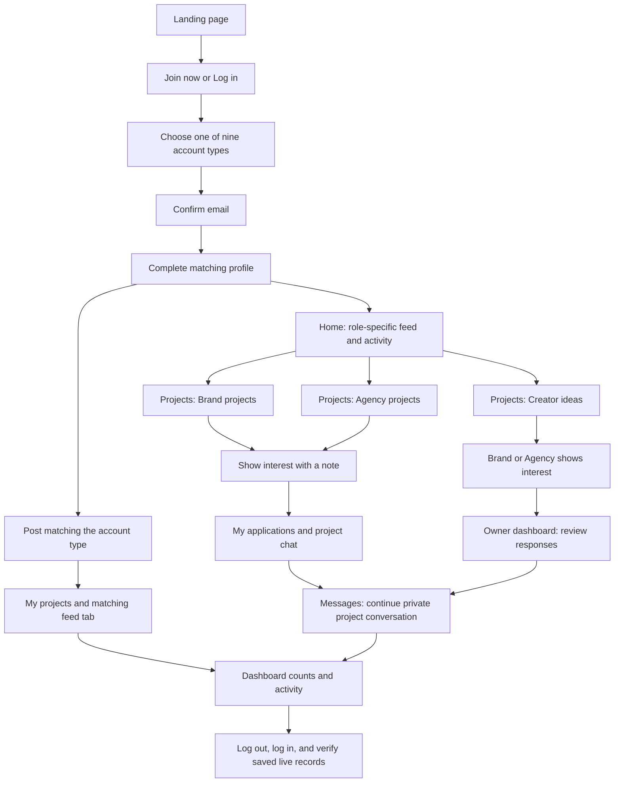

# Brand Media Collab account journeys and UI acceptance checklist

This document describes what a member should click, what the page should show, and what data should persist. Use it to review the deployed website with separate test accounts for Creator, Brand, Agency, Celebrity, Event, Media, Community, Distributor, and Freelancer. A passing screen means the real account data changed in Supabase and is still visible after sign-out/sign-in; a toast or a temporary browser-only change is not enough.

## Shared start: new account and every later login

1. Open `https://www.brandmediacollab.com`. The landing page shows **Log in** and **Join the network**.
2. Click **Join the network**. Choose one of the nine account types: **Creator, Brand, Agency, Celebrity, Event, Media, Community, Distributor, or Freelancer**. Enter name, email, and password, then submit.
3. If email confirmation is enabled in the Supabase project, confirm using the link delivered to that address. The confirmation link returns to Brand Media Collab profile setup.
4. Complete and save the profile. The selected account type and account owner must be saved to the signed-in user’s record.
5. Continue to Home. The header should show the same account name and correct type.
6. Use **Log out**, then log back in with the same email and password. The correct profile, account type, posts, applications, saved items, messages, and activity must return. A member must never see another test account’s identity or private data.
7. If the password is forgotten, use **Forgot password**, open the reset email, set a new password, and sign in. The reset must return to Brand Media Collab and preserve the account.

## Creator / Influencer journey

1. **Profile:** choose Creator / Influencer at signup. Fill the Creator profile, location, content categories, languages, bio, and available portfolio/social details. Save. **My profile** shows this Creator; **Edit profile** edits only this account and must not offer a switch to Brand or Agency.
2. **Browse:** on **Home**, open **Brand projects** or **Agency projects**. On **Projects**, those are separate tabs. Search and filters narrow the selected type; the displayed count matches visible live posts.
3. **Review a post:** open a Brand or Agency opportunity and inspect the project owner, brief, category, platform, deadline, delivery date, budget/compensation, and usage terms before applying.
4. **Show interest:** click **Interested**, add a short note, and submit. The application appears once under **My applications** with the correct post, owner, status, and note. The post owner can see the same application.
5. **Communicate:** use the project-linked chat when available. The other party’s reply appears in that same conversation after refresh and later login. Unread counts and activity relate to this conversation and post.
6. **Post an idea:** use **Post a project or idea**, choose **Creator collaboration idea**, enter the idea/brief and timing, then save. It appears under **My projects** and **Creator ideas**, not Brand projects or Agency projects. Brand/Agency members can discover the idea and express interest.
7. **Dashboard:** check Creator ideas owned by this account separately from Brand projects, Agency projects, and applications sent to other members’ posts. Date range changes the rows and totals together.

## Brand journey

1. **Profile:** choose Brand at signup. Enter the brand/company name, location, category, bio, and requested brand details. Save. **My profile** and **Edit profile** stay on this Brand account.
2. **Post:** click **Post a project or idea** and create a **Brand campaign**. Add project name, category, location/market, brief, application close date, delivery date, deliverables and optional budget, Creator tiers, platforms, usage/advertising terms, and status. Save as **Open** to publish.
3. **Verify placement:** the post appears under **Brand projects** on Home and Projects and under this Brand’s **My projects**. A Draft should stay private to its owner; a paused/closed post should no longer be an open discovery opportunity.
4. **Review:** open the Brand project’s responses or the Brand projects area in **Dashboard**. Each interested Creator, note, status, and application count must match the real application rows.
5. **Collaborate:** open a private conversation tied to the specific campaign and Creator. Send a reply, revisit the conversation, and confirm the message remains there. Bulk campaign updates should be delivered as separate one-to-one messages to selected interested Creators, not as a public/group leak.
6. **Dashboard:** Brand project performance is separate from Creator ideas, Agency projects, and applications this Brand sent to other people’s posts. The date range recalculates each table and summary.

## Agency journey

1. **Profile:** choose Agency at signup. Enter agency/company name, agency type, location, bio, and requested details. Save. **My profile** and **Edit profile** stay on this Agency account.
2. **Post:** click **Post a project or idea** and create an **Agency campaign**. Add project name, category, location, brief, deadlines, deliverables/budget, Creator tiers, platforms, and usage terms. Save as **Open** to publish.
3. **Verify placement:** the post appears under **Agency projects** on Home and Projects and under this Agency’s **My projects**. It must not be mixed into Brand projects or Creator ideas.
4. **Review:** the Agency projects area in **Dashboard** shows this Agency’s campaigns, interested Creators, notes, statuses, and matching totals.
5. **Collaborate:** open a conversation for the selected campaign and Creator. Replies persist in that conversation. Send campaign updates individually to interested members; confirm the activity is connected to the correct Agency project.
6. **Dashboard:** Agency projects are their own table, separate from Brand projects, Creator ideas, and applications sent. Date filters update rows and counts consistently.

## Celebrity journey

1. Choose **Celebrity** at signup; complete public/stage name, profession/talent category, location, bio, category and required private phone. Representation status can be recorded where available; the code does not establish agent delegation permissions.
2. Save the profile incomplete until every database-required field passes. Opt in to discovery in Settings; verify Explore shows the Celebrity type and hides the profile when discoverability is off.
3. Create a `celebrity_project`, publish it and verify it appears in the Celebrity project category and the owner’s project list.
4. Use a separate eligible account to review the brief and apply; the owner reviews/changes status. Confirm notifications and project-linked chat only after accepted collaboration.
5. Edit, refresh, sign out/in and confirm data remains. **Live steps not executed in this audit.**

## Event journey

1. Choose **Event** at signup; fill the organization name, event category/type, description, location, primary contact, event scale/audience and relevant dates as requested by the current form. Source-level completion constraints require the organization baseline fields; exact hosted validation remains untested.
2. Save and opt in to Explore. Confirm the Event profile is visible only when discoverability is enabled.
3. Create an `event_project` with event brief, location, delivery/application dates and target collaborators; publish and confirm its category and owner list.
4. Have a separate account apply, then review/accept or reject. Accepted project collaboration should enable chat; verify notification/status consistency with both accounts.
5. Edit and confirm persistence after refresh/relogin. Calendar booking/invites are not a verified feature.

## Media journey

1. Choose **Media**; complete organization/publication name, media category/type, audience, description, location and primary contact. Add website, media types, content formats or social links where the form supports them.
2. Save, enable discovery and check the role filter/card. Confirm private contact data is not present in public discovery output.
3. Publish a `media_project`; verify only the Media project category and owner dashboard include it.
4. Receive an application from a second account, update its status and validate both sides’ persisted view, notification and accepted-chat permissions.
5. Edit and verify after refresh. Publication integrations and audience/traffic analytics are not verified.

## Community journey

1. Choose **Community**; provide community/organization name, community type, membership type/range, category, location, description, primary contact, logo/avatar and private phone. Profile completion trigger requires the organization baseline plus community type, location and avatar.
2. Save, explicitly enable discovery, and use Community filters/search. Check that private contact values remain hidden.
3. Create a `community_project` and confirm the Explore/Projects category, owner view and role count update from persisted data.
4. A different account applies; review status, notification and accepted collaboration chat. There is no team/member invite workflow in the current schema.
5. Edit/save, refresh, log out/in and verify persistence.

## Distributor journey

1. Choose **Distributor**; fill organization name, distributor/company type, category, location, description, primary contact, logo, distribution regions, business capabilities, website and private phone. Completion validation requires organization baseline, location/logo and company type.
2. Save, opt in to discovery and verify Distributor appears in profile filters/search.
3. Publish a `distribution_project` describing industries/regions/channels and desired collaborators; verify category and owner dashboard.
4. Another account applies; owner reviews and changes status, then confirms notification and chat eligibility on both accounts.
5. Edit and verify persistence. Product catalog/order/distribution transactions are not implemented.

## Freelancer journey

1. Choose **Freelancer**; complete name, profession, at least one skill, category, location, bio, profile image, languages, portfolio/website, availability/work preference, private full name and phone. These required fields are enforced in the profile completion trigger.
2. Save, opt in to Explore and use profession/skills/services/location/language filters. Verify public profile output excludes private contact fields.
3. Publish a `freelance_project` (service/availability brief) and confirm it appears in the matching category and owner list.
4. Apply to another suitable opportunity with a note; confirm application status and owner notification. Project chat is subject to accepted collaboration/connection eligibility.
5. Edit, refresh and log out/in to confirm data persistence. Contracts/invoicing are outside the current product implementation.

## Shared navigation and expected behavior

- **Home:** the signed-in member’s own identity/profile card, current live posts grouped by the owner’s saved account type, and relevant recent activity. Brand projects show only Brand-owned posts, Creator ideas only Creator-owned posts, and Agency projects only Agency-owned posts.
- **Projects:** the same strict separation applies to all three tabs. Selecting one tab must hide cards belonging to the other two types; counts must match the live Open posts in that selected category. Search/filter affects the current tab; **My applications**, **Saved projects**, and **My projects** show only the signed-in account’s records.
- **Dashboard:** separate tables for Brand projects, Creator ideas, Agency projects, and applications sent. Each displayed count is derived from actual records, not sample totals.
- **Messages:** each conversation names the other member and linked project/idea. Sending and receiving messages persists. New unread messages update the message badge and project activity count.
- **Profile privacy:** public profile details are visible as intended, while email, phone, and private contact data remain private unless the member chooses to share them.

## Acceptance run before calling a role complete

Use one disposable test account for each of the nine roles. For every role: create/sign in; save its profile; post one item; confirm it appears in its matching tab; select the other tabs and confirm the card disappears; confirm counts match its Open posts; use another eligible role to show interest with a note; confirm both accounts see the matching application; open the correct private conversation; exchange a message; verify unread state and dashboard/activity counts; sign out and back in; confirm all records persist and stay associated with the right accounts. Repeat for each post type. These are test steps, not claims of passed live QA.

If a button only shows a sample card, preview toast, or browser-only change, record it as not connected and do not count it as complete. Share the exact page, click, expected result, and actual result when reporting a failure.

## Known scope limits

Social network OAuth and automatic follower syncing, push notifications, and automatic Google Calendar invitation/sync are not part of this package. Messages and activity update through Supabase Realtime with a 30-second polling fallback when the realtime channel is unavailable. The owner admin console does not reveal private conversation bodies. Existing Supabase data must be preserved; do not rerun the initial schema, and this package does not automatically execute SQL migrations.
